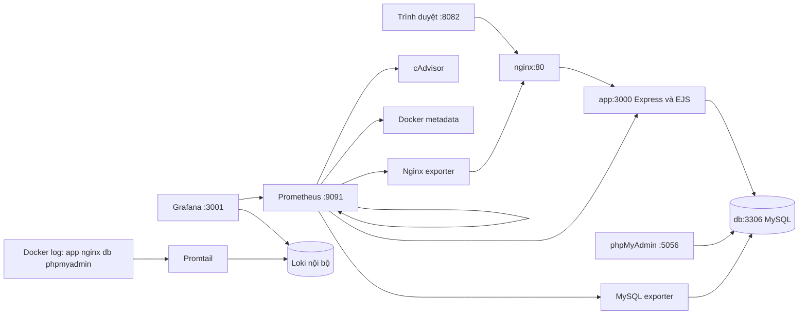

# Báo cáo đề tài: Hệ thống quản lý sinh viên

| Thông tin | Nội dung |
| --- | --- |
| Sinh viên | Trần Đức Công |
| MSSV | DTC245200418 |
| Lớp | CNTT K23I |
| Trường | Đại học Công nghệ Thông tin và Truyền thông |
| Giảng viên | Lê Khánh Dương |
| Repository | <https://github.com/CongTranDuc39/TRAN-DUC-CONG> |
| Nhánh | `master` |
| Ngày lập báo cáo | 16/10/2026 — Asia/Saigon |

Báo cáo mô tả mã nguồn và kết quả có minh chứng trong repository. Đợt nghiệm thu tổng thể giai đoạn 5 đạt 15/15 bước kỹ thuật; các mốc giai đoạn trước được giữ riêng để đối chiếu lịch sử. [KIEM_TRA.md](KIEM_TRA.md) là nhật ký chi tiết và [minh chứng giai đoạn 5](docs/evidence/phase5/README.md) lưu dữ liệu API, ảnh và transcript mới.

## 1. Mục tiêu đề tài

Xây dựng website tiếng Việt quản lý lớp, sinh viên, môn học và điểm; hỗ trợ gán lớp, nhập điểm, tính tổng kết, tìm kiếm và lọc dữ liệu. Đóng gói ứng dụng và database bằng Docker Compose để demo nhất quán trên máy cá nhân. Bổ sung reverse proxy, bảo mật cơ bản, metrics, dashboard và log tập trung để theo dõi hoạt động và kiểm chứng lỗi bằng dữ liệu thực.

Phạm vi là môi trường học tập tại localhost. Hệ thống chưa có đăng nhập/phân quyền nghiệp vụ, HTTPS công khai, triển khai HA hoặc cơ chế backup tự động; các giới hạn này được phân biệt với biện pháp hardening container.

## 2. Kiến trúc hệ thống



Chỉ bốn cổng host bind vào `127.0.0.1`: Nginx `8082`, phpMyAdmin `5056`, Prometheus `9091`, Grafana `3001`. Express, MySQL, exporter, metadata, cAdvisor, Loki và Promtail chỉ giao tiếp trong mạng Docker. Tên service được dùng làm DNS nội bộ, không cố định IP container.

Tên project Compose hiện có là `qlsv-trancong`; giữ nguyên để dùng đúng named volume và không tạo stack thứ hai. Nhãn Loki `project="student-management"` là tên logic phục vụ truy vấn. Các volume gồm MySQL, Prometheus, Grafana, Loki và vị trí đọc Promtail, tách dữ liệu khỏi vòng đời container.

## 3. Express.js và EJS

Express.js nhận request, áp dụng bảo vệ request và render giao diện EJS. `src/app.js` định nghĩa route, `src/repository.js` truy cập dữ liệu qua `mysql2`, `src/validation.js` kiểm tra trường nhập. Template trong `views/` dùng partial header/footer chung; CSS và JavaScript trình duyệt đặt trong `public/`.

Repository dùng placeholder khi thực thi SQL; giá trị tìm kiếm không được ghép trực tiếp thành SQL. Server kiểm tra ID, độ dài, định dạng, miền điểm và các khóa liên kết. EJS escape dữ liệu hiển thị, CSRF bảo vệ thao tác thay đổi dữ liệu, body được giới hạn kích thước. Các lớp bảo vệ này không thay thế xác thực người dùng nghiệp vụ.

Metrics HTTP do `prom-client` ghi theo method, mẫu route và HTTP status; log JSON ghi thời điểm, method, route chuẩn hóa, status, thời gian phản hồi. Không đưa query, body, cookie, Authorization hoặc ID tùy ý vào các label/log request.

## 4. MySQL và phpMyAdmin

MySQL 8.4 dùng InnoDB, `utf8mb4` và bốn bảng sau:

| Bảng | Nội dung | Liên kết |
| --- | --- | --- |
| `classes` | Mã lớp, tên lớp, niên khóa | Một lớp có nhiều sinh viên |
| `students` | MSSV, họ tên, liên hệ, lớp nếu có | `class_id` có thể rỗng |
| `subjects` | Mã môn, tên môn, tín chỉ | Một môn có nhiều bản ghi điểm |
| `scores` | Sinh viên, môn, học kỳ, năm học, ba điểm thành phần | Tham chiếu sinh viên và môn |

Unique key chặn trùng mã lớp, MSSV, mã môn, email nếu có và bộ sinh viên/môn/học kỳ/năm học. Khóa ngoại `RESTRICT` ngăn xóa lớp còn sinh viên hoặc sinh viên/môn còn điểm. Check constraint bảo đảm tín chỉ 1–10, học kỳ 1–3 và điểm 0–10.

Seed trong `database/init.sql` chỉ chạy khi volume MySQL mới; không chạy lại khi nâng giai đoạn. Kiểm tra thực tế trước và sau giai đoạn 5 xác nhận **8 sinh viên, 3 lớp, 4 môn và 12 bản ghi điểm**. SHA-256 nội dung từng bảng sau kiểm thử khớp baseline chụp trước thay đổi; số liệu này được kiểm đếm trực tiếp, không suy từ seed.

phpMyAdmin dùng cookie login tại `http://localhost:5056`, kết nối `db:3306`; không bật tùy chọn kết nối database tùy ý. Tài khoản `qlsv_app` dùng cho CRUD; `app-permissions-init` bỏ quyền cũ và cấp lại `SELECT`, `INSERT`, `UPDATE`, `DELETE` trên từng bảng trong bốn bảng trên, không DDL/server/`GRANT OPTION`. Tài khoản exporter riêng phục vụ metrics; root Docker secret chỉ dùng cho khởi tạo/quản trị có kiểm soát. Kiểm thử hardening kiểm tra `SHOW GRANTS` và xác nhận truy cập `mysql.user`/tạo bảng tạm bị từ chối.

## 5. Các chức năng CRUD

| Nhóm | Chức năng |
| --- | --- |
| Lớp | Thêm, danh sách/tìm kiếm, sửa, xóa khi không còn sinh viên |
| Sinh viên | Thêm, tìm kiếm/lọc theo lớp hoặc chưa gán, sửa, xóa khi không có điểm; gán/bỏ gán lớp |
| Môn học | Thêm, tìm kiếm, sửa tín chỉ, xóa khi không có điểm |
| Điểm | Chọn sinh viên/môn/học kỳ/năm học, nhập/sửa/xóa điểm; lọc theo lớp, sinh viên, môn và kỳ |
| Dashboard | Tổng số sinh viên, lớp, môn và bản ghi điểm |

Điểm môn do MySQL tính bằng cột generated, tránh chênh lệch khi ghi:

```text
Điểm môn = ROUND(chuyên cần × 0,1 + giữa kỳ × 0,3 + cuối kỳ × 0,6, 2)
Trung bình = ROUND(Σ(điểm môn × tín chỉ) / Σ(tín chỉ), 2)
```

Trung bình áp dụng cho phạm vi dữ liệu đang lọc; chưa có quy tắc học lại, chọn lần thi cao nhất hoặc quy đổi bảng điểm chính thức. Ngưỡng đạt 5,0 là quy tắc demo, không khẳng định thay thế quy chế đào tạo của trường.

## 6. Docker Compose

`Dockerfile` dùng Node.js 24 Alpine, cài dependency production từ lockfile và chạy `USER node`. Compose mô tả phụ thuộc, healthcheck, secret runtime và các named volume. Service khởi tạo tài khoản chạy một lần rồi exit 0; không phải tiến trình cần duy trì liên tục.

Trên Windows, dùng `scripts/local-stack.ps1` để Validate/Up/Ps thay cho Compose tự nạp cấu hình cục bộ. Script truyền `--env-file .local/empty.env`, không đọc `.env`; thông tin đăng nhập hiện có được giải mã DPAPI trong bộ nhớ và khôi phục biến môi trường sau khi chạy. `.local/`, `.env`, dependency và kết quả tạm bị loại khỏi Git/build; ảnh minh chứng vẫn được lưu Git nhưng loại khỏi Docker image.

```powershell
powershell -NoProfile -ExecutionPolicy Bypass -File .\scripts\local-stack.ps1 -Action Validate
powershell -NoProfile -ExecutionPolicy Bypass -File .\scripts\local-stack.ps1 -Action Up
powershell -NoProfile -ExecutionPolicy Bypass -File .\scripts\local-stack.ps1 -Action Ps
```

Giữ nguyên project, commit và dữ liệu hiện có; không dùng `docker compose down -v`, xóa volume hoặc thao tác lên project khác. Restart/build container không đồng nghĩa xóa named volume.

## 7. Nginx reverse proxy

Nginx là điểm vào duy nhất của website: `127.0.0.1:8082 → nginx:80 → app:3000`. Express không có host port. Proxy dùng DNS Docker để cập nhật upstream sau khi app được tạo lại, truyền `Host`, `X-Real-IP`, `X-Forwarded-For`, `X-Forwarded-Proto`; tại biên local, XFF do client tự gửi được ghi đè.

Listener `8080` cung cấp `stub_status` nội bộ cho Nginx exporter; `/metrics` và `/stub_status` không được mở qua website. Access log ghi stdout, error log ghi stderr; URI trong access log bỏ query string, không ghi request header/body. `nginx -t` và kiểm thử proxy xác nhận cấu hình và đường đi request thực tế.

## 8. Security headers

| Header | Giá trị cấu hình |
| --- | --- |
| `X-Content-Type-Options` | `nosniff` |
| `X-Frame-Options` | `DENY` |
| `Referrer-Policy` | `strict-origin-when-cross-origin` |
| `Permissions-Policy` | `camera=(), microphone=(), geolocation=()` |

Nginx áp dụng header bằng `always` để bao phủ phản hồi lỗi và ẩn header upstream trùng. CSP có `frame-ancestors 'none'`; ẩn phiên bản Nginx và giới hạn body 32 KiB. Kiểm thử kiểm tra giá trị và số lần xuất hiện header trên response 200, 404 và các lỗi đầu vào dự kiến. HSTS/HTTPS chưa áp dụng cho địa chỉ HTTP localhost của đề tài.

## 9. Prometheus và Grafana

Prometheus scrape mỗi 15 giây, lưu dữ liệu trong `prometheus_data`, retention 7 ngày. Sáu job là `prometheus`, `express`, `cadvisor`, `docker-metadata`, `mysql`, `nginx`. Exporter MySQL và Nginx chuyển số liệu của dịch vụ thành endpoint Prometheus; cAdvisor đo CPU/RAM container.

Docker Desktop/containerd có thể thiếu Compose label trên metric cAdvisor. Helper `container-metadata` chỉ đọc danh sách container của project hiện tại, phát metric ánh xạ ID/service; dashboard join metric này với số liệu cAdvisor thật. Helper không tạo số liệu CPU/RAM giả.

Grafana tự provision datasource `Prometheus` UID `prometheus` tại `http://prometheus:9090`, dashboard **Student Management Monitoring**, UID `student-management`, thư mục **QLSV**. Dashboard có 17 panel với 21 truy vấn: CPU/RAM container, request, HTTP status, độ trễ, lỗi, MySQL up/kết nối, Nginx up/kết nối/request và targets.

```promql
up
sum(rate(qlsv_http_requests_total[5m]))
sum by (status_code) (qlsv_http_requests_total)
histogram_quantile(0.95, sum by (le) (rate(qlsv_http_request_duration_seconds_bucket[5m])))
mysql_up
mysql_global_status_threads_connected
nginx_up
```

Số liệu là theo thời gian, thay đổi theo traffic. Chờ ít nhất hai chu kỳ scrape sau khi khởi động/tạo request để `rate()` có dữ liệu. Không dùng ảnh cũ thay cho truy vấn đang chạy; bằng chứng giai đoạn 5 lưu riêng các kết quả mới.

## 10. Loki, Promtail và LogQL

Promtail đọc Docker stdout/stderr của đúng project Compose `qlsv-trancong`, whitelist `app|nginx|db|phpmyadmin`. Docker discovery lọc ở API và relabel tiếp tục giữ project/service; không glob log toàn máy, không đưa Docker environment thành label. Mỗi stream có `project="student-management"`, `service`, `container`, `stream`.

Datasource Loki UID `loki` được provision tự động tại `http://loki:3100`. Loki không publish cổng host; Grafana truy vấn trong mạng Docker. Loki dùng TSDB v13/index 24 giờ, filesystem, WAL, named volume `loki_data`; Promtail giữ positions trong `promtail_positions`.

```logql
{project="student-management"}

{project="student-management", service="nginx"} |= "GET /health"

sum(count_over_time({project="student-management"}[5m]))

{project="student-management", service="nginx"} |~ "\" [45][0-9]{2} "
```

Request demo `/__loki_probe_404` chỉ đọc và trả 404; không tạo lỗi 5xx hoặc dừng MySQL để chứng minh LogQL. MySQL thu startup/error log sẵn có, không bật general query log; có thể cần khoảng thời gian dài hơn để xem startup. Count là số dòng log, có thể gồm cả Express và Nginx cho cùng request.

Retention `168h`, compactor bật retention, chu kỳ 10 phút, delay xóa chunks 2 giờ và delete-request store filesystem. Xóa diễn ra bất đồng bộ; cấu hình hợp lệ không chứng minh đã chờ đủ 7 ngày. [Tài liệu retention chính thức](https://grafana.com/docs/loki/latest/operations/storage/retention/) mô tả cơ chế compactor.

## 11. Hardening

Giai đoạn 5 bổ sung chính sách user, capability, `no-new-privileges`, filesystem chỉ đọc, tmpfs và quyền MySQL mà không đổi CRUD/seed/mật khẩu. Nghiệm thu kiểm tra Docker inspect chọn trường, `/proc/1/status` trong app, probe ghi rootfs và tmpfs; không in toàn bộ container environment. Đây là xác nhận cấu hình/chức năng trong môi trường demo, không phải kiểm toán bảo mật toàn diện.

| Thành phần | Hardening |
| --- | --- |
| App và hai service init | User `node:node`, `cap_drop: ALL`, rootfs chỉ đọc, `no-new-privileges`; app có tmpfs `/tmp` |
| Exporter/Prometheus/Grafana/Loki/Promtail/metadata | Rootfs chỉ đọc, bỏ toàn bộ capability, cấm nâng quyền; storage cần ghi dùng named volume |
| MySQL | Rootfs chỉ đọc, data volume và tmpfs socket/tmp; bỏ capability rồi thêm `CHOWN`, `DAC_OVERRIDE`, `SETUID`, `SETGID` cho root entrypoint chuyển sang `mysql` |
| Nginx | Rootfs chỉ đọc, tmpfs cache/run/tmp; giữ `CHOWN`, `SETUID`, `SETGID`, `NET_BIND_SERVICE` cho master/worker và port 80 |
| phpMyAdmin | `no-new-privileges`, bỏ capability rồi thêm nhóm cần cho Apache/entrypoint; tmpfs session/run/lock; rootfs ghi được vì entrypoint tạo cấu hình secret |
| cAdvisor | `privileged` là ngoại lệ; rootfs/host mount chỉ đọc, `no-new-privileges`, tmpfs tạm; không tuyên bố đã drop capability dưới privileged |

Tất cả 14 container thuộc stack, gồm 12 service chạy thường trực và hai init, khai báo `no-new-privileges`. Có 13 rootfs chỉ đọc, ngoại lệ phpMyAdmin; 13 container `cap_drop: ALL`, ngoại lệ cAdvisor. Ba image cần root entrypoint được thêm lại capability giới hạn. Các tmpfs thông thường dùng `noexec,nosuid,nodev`; Grafana `/tmp` giữ thực thi cho helper/plugin runtime, dùng `nosuid,nodev`. Compose có bảy healthcheck tường minh, cAdvisor kế thừa healthcheck từ image; cả tám service này healthy trong nghiệm thu.

Promtail chạy root để truy cập Docker socket; helper metadata chạy non-root nhưng thêm group 0. Mount socket `:ro` không hạn chế HTTP verb hoặc quyền Docker API. Giới hạn project trong collector là bộ lọc log, không phải cơ chế phân quyền daemon. [Tài liệu bảo mật Docker](https://docs.docker.com/engine/security/) là cơ sở đánh giá rủi ro daemon/capability. Source không chứa mật khẩu thật; Grafana dùng secret file, secret exporter tách riêng, và không commit DPAPI.

Loki dùng image distroless thiếu shell/curl/wget; readiness `/ready` được kiểm tra qua datasource proxy Grafana, không khai báo healthcheck không thể chạy. Các service quan trọng khác có healthcheck phù hợp; kết quả runtime và ngoại lệ cuối cùng được ghi ở đầu `KIEM_TRA.md`.

## 12. Kiểm thử và minh chứng

Mỗi đợt kiểm thử giai đoạn 5 tạo bằng chứng riêng trong `docs/evidence/phase5/`, không ghi đè phase3/phase4. Quy trình gồm validate/build/up/ps, syntax, unit, CRUD, reverse proxy/headers, monitoring, logging, hardening và Git audit. Integration test tạo dữ liệu tạm, kiểm tra đủ bốn CRUD rồi dọn; kiểm đếm dữ liệu trước/sau để phát hiện mất dữ liệu.

`npm run test:final` gọi `scripts/verify-final.ps1`, chạy 15 bước và lưu transcript riêng từng bước, gồm Compose Ps sau toàn bộ kiểm thử. Tùy chọn `-Capture` thêm ba helper chụp monitoring/logging/website, tổng cộng 18 bước. Baseline đếm và SHA-256 bốn bảng được chụp trước thay đổi; kiểm thử hardening so cả nội dung bốn bảng với baseline, không chỉ số dòng. Cửa sổ xác nhận không có HTTP 5xx bắt đầu sau startup, truy vấn Nginx log thật qua Loki; không tuyên bố deployment không gián đoạn hoặc không có lỗi trong lịch sử.

Lần kiểm tra đầu phát hiện healthcheck PHP dùng `file_get_contents` không tương thích vì image tắt `allow_url_fopen`, trong khi request HTTP thực tế tới phpMyAdmin vẫn 200. Đã đổi healthcheck sang PHP cURL gửi HEAD nội bộ, timeout 4 giây, yêu cầu HTTP 200; giữ nguyên `allow_url_fopen` bị tắt. Kết quả lần đầu được giữ trong `checks/initial-verification-summary.json` và `checks/initial-hardening.txt`, không xóa để làm đẹp báo cáo; chỉ kết quả lần nghiệm thu sau sửa mới dùng làm kết luận.

Baseline lưu cả nội dung/timestamp của database trước thay đổi giai đoạn 5, không phải giá trị chuẩn cho mọi database tạo mới. Thao tác demo hợp lệ sau nghiệm thu hoặc seed mới có timestamp khác sẽ làm hash khác. Không ghi đè baseline lịch sử để ép đạt; kiểm chứng database khác cần baseline độc lập được chụp trước thay đổi. Các nhóm CRUD/proxy/monitoring/logging vẫn có thể chạy riêng khi không áp dụng phép so nội dung với mốc database cũ.

| Nhóm kiểm thử giai đoạn 5 | Kết quả thực tế |
| --- | --- |
| Runner tổng thể | 15/15 bước exit 0, từ 08:00:25Z đến 08:01:30Z ngày 16/10/2026 |
| Cấu hình | Compose, Nginx, Prometheus, Loki, Promtail hợp lệ; build/up đạt |
| JavaScript và unit | 24 file hợp lệ; 19/19 test đạt |
| CRUD và proxy | 9 nhóm CRUD và 6 kiểm tra proxy/header đạt |
| URL/health | Website, `/health`, phpMyAdmin, Prometheus, Grafana HTTP 200 sau redirect; DB connected và Grafana database ok |
| Monitoring | 9 nhóm đạt; 6/6 targets UP, `up=1`; 17 panel/21 truy vấn thật và CPU/RAM đủ 12 service |
| Logging | 9 nhóm đạt; Loki ready 200, datasource OK, 7 truy vấn, log thật app/nginx/db/phpmyadmin, health 200, probe 404 và count dương |
| Hardening | 7 nhóm đạt; 14 container đúng chính sách, 12 running, hai init exit 0; app UID 1000, CapEff 0, NoNewPrivs 1 và EROFS |
| Quyền MySQL/dữ liệu | Chỉ CRUD bốn bảng; system read và DDL bị từ chối; số dòng và bốn SHA-256 khớp baseline |
| Không có HTTP 5xx | Tái kiểm tra sau capture: query Nginx trong Loki trả rỗng từ 08:00:42.7451994Z đến 08:04:40.703Z; có ingestion barrier xác nhận log mới đã tới Loki |
| Minh chứng trình duyệt | 15 ảnh thật đã được mở xem; Targets, dashboard, datasource và Explore có dữ liệu; hardening sau chụp tiếp tục đạt 7 nhóm |

Lần monitoring nghiệm thu cuối chờ ba lượt scrape có giới hạn do app vừa tạo lại: dữ liệu p95 ban đầu chưa hữu hạn và CPU/metadata cần warm-up. Sau đó toàn bộ 21 truy vấn đạt; transcript giữ các lần chờ thực tế. Không thay số liệu bằng fixture. Đợt kiểm tra này không cố ý tạo lỗi 5xx; 4xx đầu vào/CSRF/404 là các trường hợp dự kiến.

Bảng chi tiết và các file tương ứng nằm tại [KIEM_TRA.md](KIEM_TRA.md). Đã chụp và mở xem 15 ảnh: bảy ảnh website/health/GitHub, ba ảnh monitoring và năm ảnh Loki/Explore; `capture-results.json` ghi thời điểm, SHA-256 và trạng thái kiểm tra từng ảnh. Kiểm tra lại hardening sau chụp lúc 08:04:43Z vẫn đạt, dữ liệu không đổi. Kết quả phase3/phase4 vẫn nằm riêng trong các thư mục lịch sử. Ảnh GitHub và `git-history.txt` phản ánh remote qua `7690551` trước commit giai đoạn 5; hash mới và đồng bộ remote được kiểm tra riêng sau push.

## 13. Lịch sử các commit Git

| Giai đoạn | Commit | Nội dung |
| --- | --- | --- |
| 1 | [`0fff1ba`](https://github.com/CongTranDuc39/TRAN-DUC-CONG/commit/0fff1ba) | `feat: implement student management CRUD with MySQL` |
| 2 | [`78279da`](https://github.com/CongTranDuc39/TRAN-DUC-CONG/commit/78279da) | `feat: configure nginx reverse proxy and security headers` |
| 3 | [`dedd6cb`](https://github.com/CongTranDuc39/TRAN-DUC-CONG/commit/dedd6cb) | `feat: add prometheus and grafana monitoring` |
| 4 | [`7690551`](https://github.com/CongTranDuc39/TRAN-DUC-CONG/commit/7690551) | `feat: add loki and promtail centralized logging` |
| 5 | Hash cuối tra bằng `git log -1 --oneline` sau bàn giao | `security: harden deployment and verify project requirements` |

Không rewrite lịch sử và không force push. Bằng chứng Git gồm log trước commit và đối chiếu local HEAD/`origin/master` sau push; hash commit giai đoạn 5 được báo ở bàn giao vì commit không thể tự chứa hash cuối cùng của chính nó.

## 14. Hạn chế, backup và hướng phát triển

Promtail [đã EOL ngày 02/03/2026](https://grafana.com/docs/loki/latest/send-data/promtail/), không còn cập nhật/hỗ trợ. Đề tài giữ Promtail theo yêu cầu giai đoạn 4; cần chuyển Grafana Alloy hoặc collector còn được hỗ trợ trước khi triển khai production.

Loki filesystem một node không có HA; named volume giữ dữ liệu khi tạo lại container nhưng không thay thế backup. MySQL, Prometheus và Grafana cũng đang dùng storage cục bộ trên một Docker Desktop; lỗi máy/đĩa hoặc mất secret DPAPI có thể làm mất khả năng khôi phục. Retention 7 ngày không phải chính sách sao lưu.

Chính sách đề xuất, chưa phải hệ thống backup tự động đã được triển khai:

- Sao lưu logic MySQL bằng `mysqldump --single-transaction` với tài khoản backup riêng; chỉ đọc secret từ runtime trong bộ nhớ/file được bảo vệ, không đặt mật khẩu vào lệnh, log hoặc repository. Lưu dump mã hóa ngoài Git và ngoài ổ chứa volume.
- Lưu cấu hình versioned trong Git; sao lưu Grafana database/volume nhất quán, Loki và Prometheus bằng snapshot hoặc quy trình backup phù hợp từng hệ thống. Không sao chép nóng các file database rồi mặc định bản sao hợp lệ.
- Giữ thông tin khôi phục secret trong kho bí mật riêng. File DPAPI phụ thuộc tài khoản Windows/máy; chỉ copy XML sang máy khác không đủ để giải mã.
- Theo lịch dự kiến hằng ngày và trước thay đổi lớn, ghi thời điểm, checksum, thời gian giữ và người quản lý bản sao. Chính sách giữ mẫu có thể là 7 bản ngày và 4 bản tuần, cần điều chỉnh theo dung lượng và yêu cầu thực tế.
- Kiểm tra restore trong project Docker cô lập, cổng/volume mới, import dump bằng tài khoản quản trị chỉ dành cho môi trường thử. Chạy health, đếm bốn bảng và smoke CRUD trên bản khôi phục trước khi coi backup dùng được; không restore đè database đang demo. Dọn môi trường khôi phục chỉ sau khi xác nhận chính xác tên và được cho phép.

Giai đoạn 5 không tuyên bố đã chạy backup/restore, RPO/RTO hoặc chịu tải khi chưa có minh chứng. Hướng phát triển tiếp theo là HTTPS, đăng nhập/RBAC, quản lý bí mật độc lập Windows, socket proxy giới hạn API, pin image theo digest kèm cập nhật định kỳ, cảnh báo metrics/log, CI kiểm thử và diễn tập khôi phục. Trước public internet cần đánh giá bảo mật và dữ liệu cá nhân riêng.
