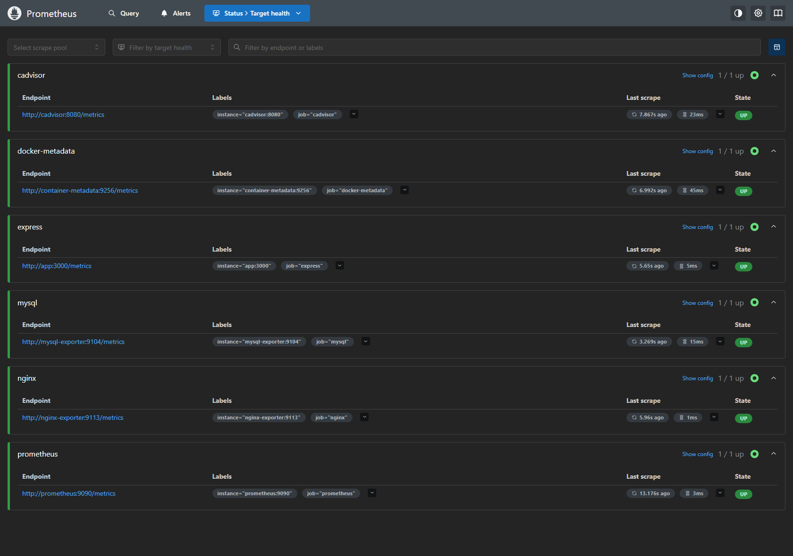
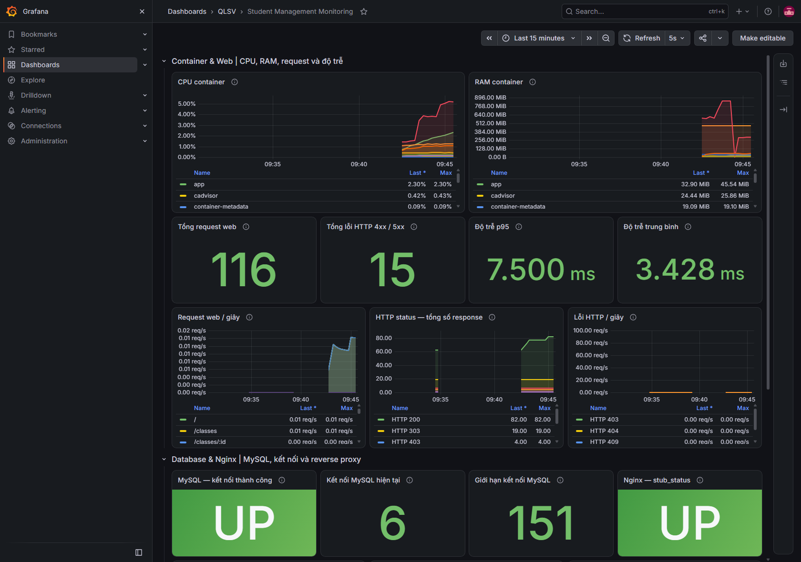
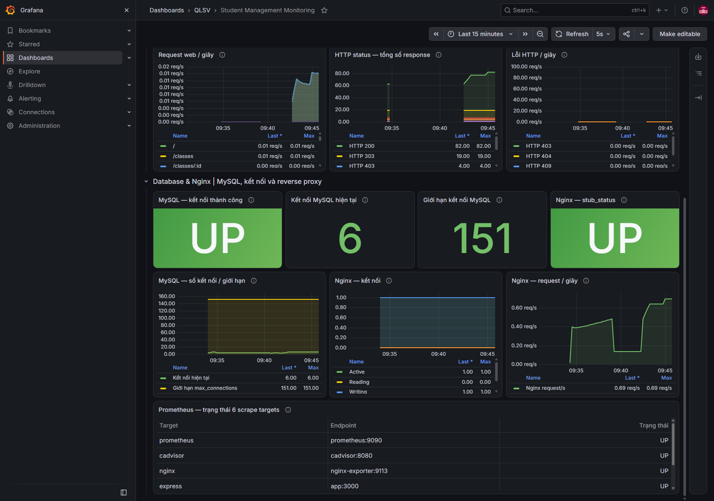

# Minh chứng giai đoạn 3

Hệ thống quản lý sinh viên — Trần Đức Công, DTC245200418. Kiểm tra ngày 16/10/2026 trên Docker Desktop với Linux containers.

Kết quả: 10 service đang chạy, service khởi tạo exporter exit 0; 6 targets UP; Grafana datasource hoạt động; dashboard có 17 panel và 21 truy vấn dữ liệu thực. CPU/RAM được thu từ cAdvisor và giới hạn đúng container của project `qlsv-trancong` bằng metadata Docker.

| File | Nội dung |
| --- | --- |
| [compose-ps.txt](compose-ps.txt) | Trạng thái container sau khi khởi chạy |
| [prometheus-targets.json](prometheus-targets.json) | 6 targets và thời điểm scrape |
| [prometheus-up.json](prometheus-up.json) | Truy vấn `up`, 6 giá trị bằng 1 |
| [grafana-health.json](grafana-health.json) | Grafana health |
| [grafana-datasource-health.json](grafana-datasource-health.json) | Kết nối datasource Prometheus |
| [dashboard-query-results.json](dashboard-query-results.json) | Kết quả 21 truy vấn dashboard |
| [summary.json](summary.json) | Tổng hợp kiểm thử monitoring |

## Prometheus Targets

## Container và web

## Database và Nginx

Chụp lại bằng `node scripts/capture-monitoring-evidence.js` sau khi stack sẵn sàng; có thể dùng `CHROME_PATH` để chọn trình duyệt Chromium. Báo cáo và lệnh kiểm tra đầy đủ nằm trong `KIEM_TRA.md` ở thư mục gốc. Các minh chứng không chứa mật khẩu, cookie hoặc header xác thực và được loại khỏi Docker build.
